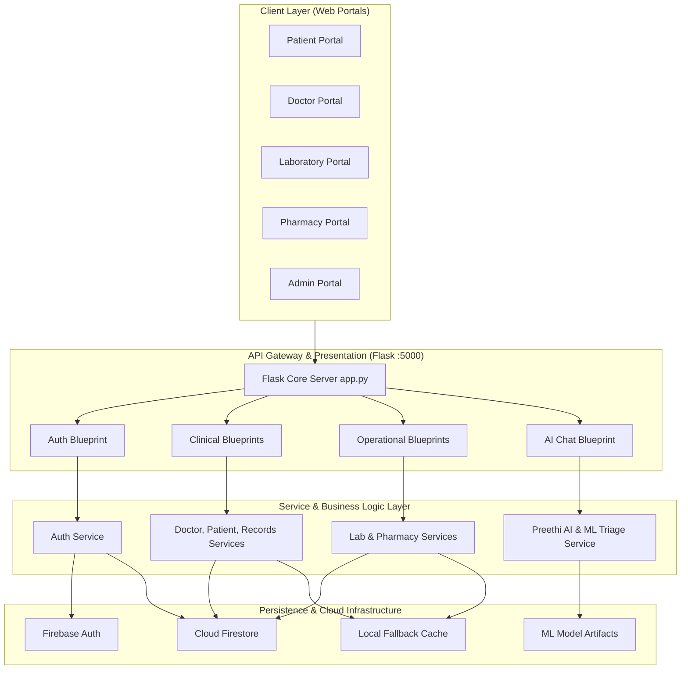

# MediMate-AI: System Architecture

## 1. Architectural Overview
MediMate-AI follows a modular, decoupled 4-tier healthcare architecture designed for high availability, security, and low latency.

---

## 2. Layer Specifications

### 2.1 Client Layer
- Pure **Vanilla HTML/CSS/JS** architecture eliminating bloated single-page framework dependencies.
- Unified Emerald Healthcare design system tokens (`var(--primary)`, `var(--bg-main)`).
- Role-specific security checkpoints validating authenticated session state before rendering sensitive health telemetry.

### 2.2 Routing & Presentation Layer (Flask)
- Organized into **15 isolated Blueprints** under `backend/routes/`:
  - `auth.py`: Registration and Firebase ID token resolution.
  - `admin.py`: User lifecycle and hospital metrics.
  - `doctor.py`, `patient.py`, `appointment.py`, `department.py`: Clinical coordination.
  - `laboratory.py`, `pharmacy.py`, `medicine.py`, `prescription.py`: Diagnostic and pharmaceutical operations.
  - `vitals.py`, `health_records.py`, `report.py`, `notification.py`, `ai_chat.py`: Telemetry, records, and AI assistance.

### 2.3 Service Layer
- Independent domain services located under `backend/services/` encapsulating validation, transaction logic, and Firebase Admin SDK bindings.

### 2.4 Data & AI Layer
- Real-time NoSQL collections in **Google Cloud Firestore**.
- Supervised clinical classification models (`RandomForestClassifier`) deployed for real-time risk triage.
