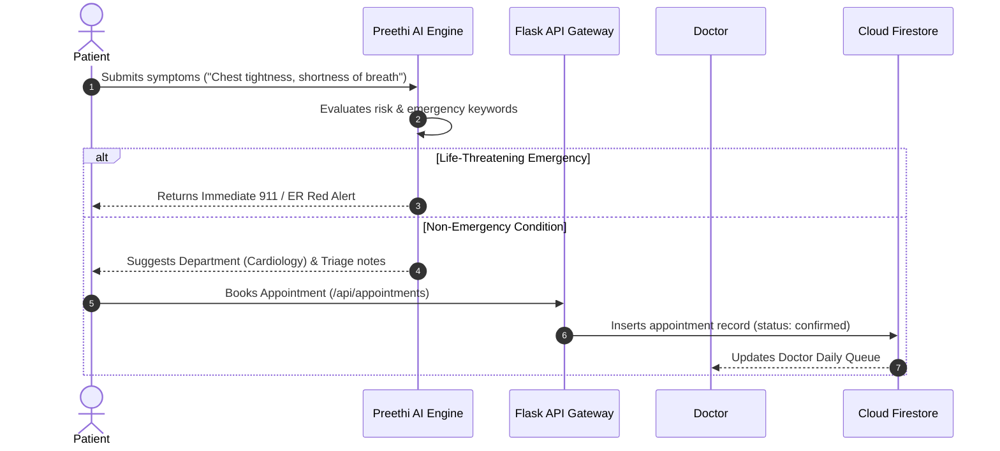
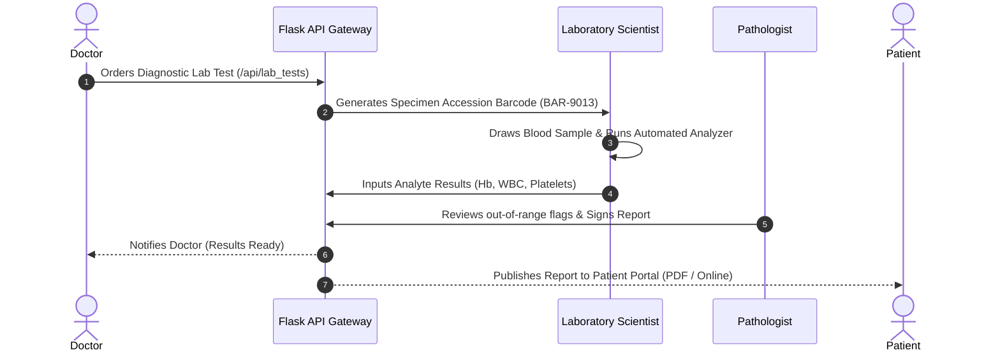
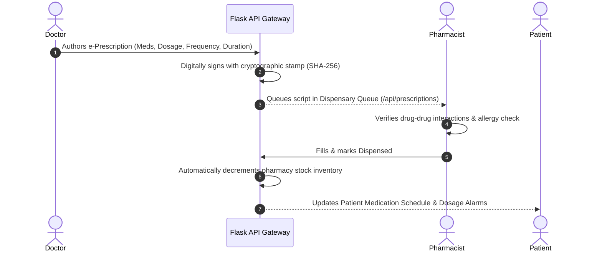

# MediMate-AI: Data Flow Diagrams

## 1. Patient Triage & Appointment Flow

---

## 2. Diagnostic Investigation & Lab Report Flow

---

## 3. Electronic Prescription & Pharmacy Dispensation Flow

